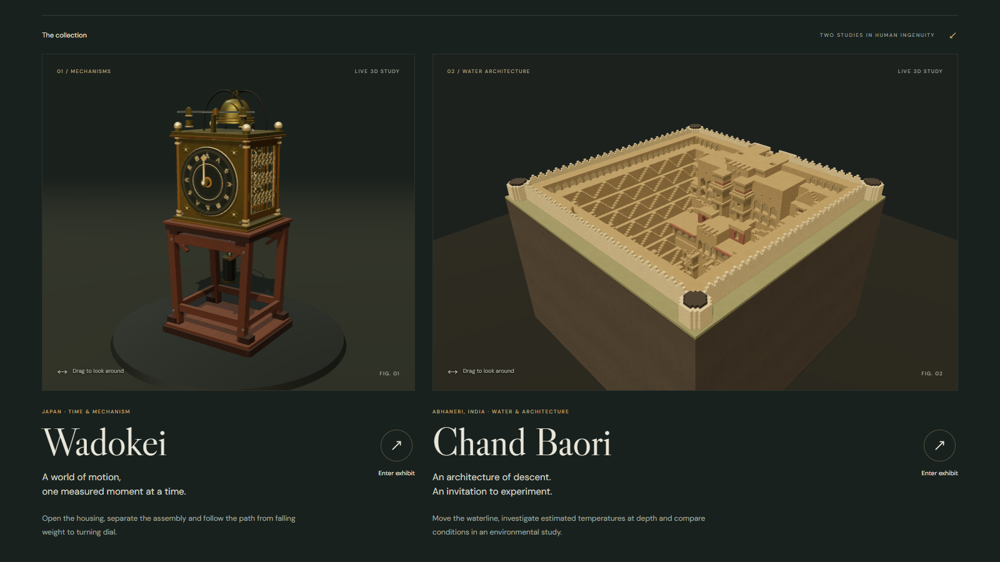

# YANTRA
### From historical text to explorable 3D.

**What if you could step inside something you had only read about?**

A historical passage might describe a clock, a building, or a way of storing water. Reading it tells us something. Being able to explore it, change a setting, and ask “why?” can help us understand much more.

**YANTRA is an interactive heritage museum—and the foundation for the text-to-3D experience we want to build.** Today, you can explore a Japanese mechanical clock and an Indian stepwell, run simple experiments, and ask an AI guide to explain or operate them.

> **The idea:** Bring a historical description. Explore possible interpretations in 3D. Ask questions. Challenge the answer. Follow the evidence.



## What we are trying to do

We want to make historical knowledge easier to understand, investigate, and discuss.

Old manuscripts, scriptures, and inscriptions can be difficult to interpret. A detail may be easy to miss. A translation may change the meaning. Two readers may imagine different structures from the same description.

Our longer-term goal is to help people turn those descriptions, across languages, into **possible 3D reconstructions tied to the original sources**. The model should show what the text supports, what has been inferred, and what remains uncertain.

The conversation matters as much as the model. You should be able to say:

- “Show me the passage that supports this.”
- “Could this part have worked differently?”
- “I disagree with that interpretation. Compare another one.”

The aim is to support students, visitors, and researchers in examining an interpretation—not to make the AI's first answer the final word.

**The journey we are working toward:**

Historical text → source-backed interpretation → possible 3D reconstruction → questions and experiments → revised understanding

## What you can try today

The current prototype uses **two prepared 3D exhibits**. Automatic manuscript-to-3D generation is the next step; it is not implemented in this version.

| Exhibit | What you can do | What it helps you understand |
| --- | --- | --- |
| **Wadokei · Japanese clock** | Rotate it, open the housing, separate the parts, inspect the mechanism, and move the regulator's weights. | How the falling weight, gears, escapement, and regulator work together to keep time. |
| **Chand Baori · Indian stepwell** | Explore the architecture, raise or lower simulated water, inspect temperature estimates at different depths, and compare scenarios. | How changing an input changes a model—and why an estimate is different from a real measurement. |

Both exhibits include camera controls, explanations, source references, and a **Guide** tab.

## Talk to the exhibit

YANTRA uses **Gemma 4 through the hosted Gemini API**. You can ask about what you see or request a supported change in ordinary language.

Try these:

| In the clock | In the stepwell |
| --- | --- |
| “Pause the clock, open it and show me the escapement.” | “Lower the water by two metres.” |
| “Move the foliot weights outward to 0.95 and explain the change.” | “Show the estimated temperature at twelve metres depth.” |
| “Walk me through the power path.” | “Is that an actual measurement? What evidence supports it?” |

**Gemma understands the request. The application's tools make the change and calculate the result. Gemma then explains what those tools returned.**

That means the guide can do more than chat: it can operate the existing exhibits. It cannot generate new 3D models or run arbitrary code. If the AI connection is unavailable, you can still use the exhibits' manual controls.

## Know what you are looking at

The project separates historical evidence from reconstruction and simulation:

- **Historical facts** link back to sources.
- **The clock** is an explanatory reconstruction, not a scan of an original artifact.
- **The stepwell model** is an artist's interpretation, not a measured architectural survey.
- **Water levels and temperatures** are educational scenarios and estimates, not live readings or recovered historical measurements.
- **Text-to-3D** is the direction we are building toward. The current exhibits demonstrate the exploration, experimentation, and conversation part of that experience.

A convincing picture is not enough. People need to be able to question how it was made and what its results mean.

## Run it on your computer

You need **Node.js 22 or newer** and npm. In the project folder, run:

```sh
npm ci
npm run dev
```

Open [YANTRA on your computer](http://127.0.0.1:5173/). Choose either exhibit from the homepage.

To enable the AI guide:

1. Copy `.env.example` to a new file called `.env.local`.
2. Put your Gemini API key in the `GEMINI_API_KEY` field.
3. Restart `npm run dev` and open **Guide** inside an exhibit.

Keep the key private. Do not put it in frontend code, prefix it with `VITE_`, or commit `.env.local`. The guide runs Gemma through the hosted API; it does not require a local AI installation. API access, usage limits, and model availability depend on your account.

See the [AI guide setup](docs/GEMMA_GUIDE.md) for details and troubleshooting.

## For people building on YANTRA

The interface uses React and TypeScript; Three.js draws the 3D exhibits. A small Node service connects the guide to the hosted API. The clock and environmental calculations live separately from the AI explanations.

| Read more | What is inside |
| --- | --- |
| [Wadokei exhibit](docs/WADOKEI.md) | Controls, clock mechanism, sources, and reconstruction limits |
| [Chand Baori exhibit](docs/CHAND_BAORI.md) | Controls, temperature equation, water model, asset details, and limitations |
| [AI guide](docs/GEMMA_GUIDE.md) | Setup, supported actions, privacy, and validation |
| [Demo walkthrough](docs/DEMO_SHOWCASE.md) | Suggested requests and a screen-recording sequence |
| [Gemma verification](docs/GEMMA_VERIFICATION.md) | Recorded test outcomes, real API checks, and known limitations |
| [Agent instructions](AGENTS.md) | Rules for making safe, consistent project changes |

Useful checks:

```sh
npm test
npm run build
npm run test:e2e
```

Browser tests use installed Chrome by default. Alternative browser setup is explained in the [Wadokei documentation](docs/WADOKEI.md#verification). These are commands you can run, not a claim that every future change has passed them.

The local demo starts both the website and its guide service. Publishing it requires a properly secured backend for the API key; uploading the website files alone will not enable the guide.

## Credits and sources

The Chand Baori model is by **siddharthbandhu**, shared on [Sketchfab](https://sketchfab.com/3d-models/chand-baori-0fec124478454f74be29a9bd3e5534b8) under [CC BY 4.0](https://creativecommons.org/licenses/by/4.0/). Original geometry is retained; presentation materials are adapted. The preview above shows that adapted presentation.

The Wadokei is built from project-created geometry, informed by historical references including the [Japan Clock & Watch Association](https://www.jcwa.or.jp/en/etc/wadokei.html). Detailed sources and the limits of each reconstruction are listed in the exhibit documentation.

YANTRA is an independent educational project, inspired by Mechanica Museum's approach to interactive exploration. It does not claim affiliation with a museum or archaeological authority.
